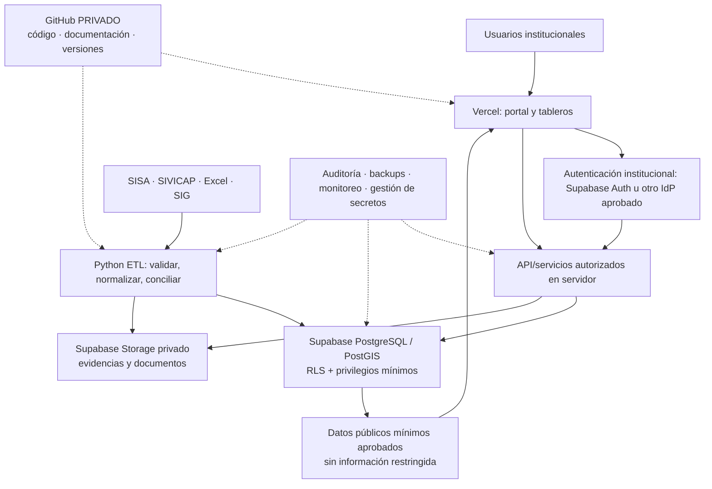

# Arquitectura objetivo · UESVALLE

**Tipo:** diseño propuesto, no infraestructura desplegada. **Principio:** denegar por defecto; clasificar antes de publicar.

## Diagrama de componentes

La flecha `DB → PUB` implica **publicación controlada de datos agregados previamente aprobados**; no concede acceso anónimo a la base interna.

## Responsabilidad de cada componente

| Capa | Función | Prohibido |
|---|---|---|
| GitHub privado | HTML/JS, scripts, pruebas, documentación, control de cambios | Datos crudos/restringidos, `.env`, secretos y respaldos de producción |
| Python/ETL | Ingesta autorizada, control de calidad, transformación, bitácora, carga | Subir insumos operativos a `data/` para servirlos sin control |
| Supabase DB | Entidades, resultados, geografía, seguimiento, integridad referencial | Consultas anónimas salvo vistas públicas aprobadas |
| Supabase Storage | PDFs, imágenes, videos, evidencias en buckets privados | Buckets públicos con material operativo no clasificado |
| Autenticación | Identidad, sesión, MFA donde aplique | Claves compartidas incrustadas en HTML/JS |
| Autorización | RLS, GRANT, rol, alcance territorial, módulo y operación | Confiar sólo en botones ocultos del navegador |
| Vercel | Frontend, API/BFF, control de sesiones, respuestas filtradas | Claves `service_role` en el cliente o CSV restringidos en artefactos estáticos |
| Gobierno y monitoreo | Propietario, responsable de tratamiento, bitácoras, revisión, respaldos | Habilitar acceso sin aprobación y pruebas de denegación |

## Flujo de datos propuesto

1. Fuentes originales autorizadas (SISA, SIVICAP, Excel, SIG) se capturan en entorno de trabajo restringido.
2. Python verifica esquema, vigencia, integridad, duplicados, codificación municipal/ARO, calidad y permisos de uso.
3. Se cargan registros a un área controlada en BD/Storage mediante credenciales de servidor con acceso mínimo.
4. Un proceso de conciliación registra totales fuente/salida, fecha, versión de transformación y errores.
5. El portal autentica al usuario; el servidor verifica sesión **y** permisos antes de responder. RLS protege las filas; Storage usa URLs firmadas o descarga autorizada.
6. Sólo se generan productos públicos tras aprobación, minimización/agregación y prueba de que no hay divulgación indirecta.
7. Auditoría, respaldos y alertas se operan fuera del frontend.

## Separación de ambientes y despliegues

- `desarrollo`: datos sintéticos, acceso restringido, sin copias operativas completas.
- `pruebas`: datos sintéticos o anonimizados; prueba de roles, regresión y carga.
- `producción`: datos aprobados y permisos formales; cambios mediante pull request y plan de reversión.
- Infraestructura y cuentas deben quedar a nombre/administración institucional o con titularidad contractual claramente autorizada.
- Autenticación de Vercel (`ssoProtection=all`) es contención actual para quienes tienen acceso a Vercel; **no sustituye** un sistema de usuarios y permisos UESVALLE.
- Antes de reutilizar Vercel como aplicación institucional, determinar si el control de acceso por perfiles puede implementarse conforme a las reglas de la entidad. Si no, evaluar proveedor de identidad institucional (p. ej. Microsoft Entra ID).
- El origen histórico `https://uesvalle.github.io/` y URL crudas deben tratarse como superficies distintas y auditarse; repositorio privado no implica automáticamente sitio privado.

## Modelo lógico inicial (a validar por proceso)

- `identidad/perfiles`: usuario, rol, estado, ARO/municipios permitidos; no duplicar datos sensibles innecesarios.
- `territorio`: municipio DIVIPOLA, localidad, geometría PostGIS, catálogo ARO.
- `agua`: sistemas, prestadores, muestras, parámetros, IRCA, puntos de muestreo, soportes.
- `operacion`: visitas/actividades, cronogramas, responsables y estados.
- `evidencias`: objetos privados, versión, metadatos mínimos, autorización y retención.
- `auditoria`: actor, operación, entidad, fecha, justificación y resultado, con minimización.
- Módulos de EIS, Zoonosis, EDAN, Alojamientos y demás deben tener modelos aislados por dominio, no una tabla universal sin controles.

## Decisiones todavía abiertas

- Titularidad institucional, aprobación de TI y tratamiento de datos.
- Proveedor de identidad (Supabase Auth vs SSO institucional), MFA y política de cuentas.
- Región de datos, límites de planes y costos por almacenamiento/egreso.
- Diseño detallado RLS/GRANT, segregación entre procesos y jerarquía ARO.
- RPO/RTO, período de retención y pruebas de restauración.
- Política de publicación de indicadores agregados frente a datos restringidos.

## Antipatrones a eliminar progresivamente

Contraseñas o hashes de contraseñas en HTML; autorizaciones sólo en JavaScript; enlaces directos a CSV/GeoJSON privados; archivos operativos incrustados en `public/`; `service_role` en frontend; buckets públicos sin revisión; URLs de Drive sin permisos validados; asumir que un 404 implica protección integral.
