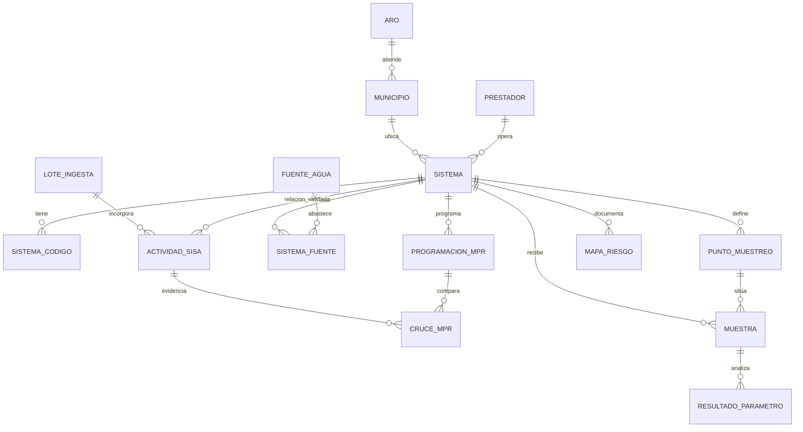

# Modelo canónico UESVALLE — Integración SISA, SIVICAP y base heredada (V1)

**Estado:** propuesta en revisión, **NO desplegada**. Corte: 28/10/2026. [SEC-11](https://github.com/UESVALLE/uesvalle.github.io/issues/13). Se complementa con [matriz de reutilización](MATRIZ_REUTILIZACION_BD_HISTORICA_V1.csv) y [contratos de origen](CONTRATOS_Y_REGLAS_ETL_SISA_V1.md).

## Evidencia que fundamenta el modelo

1. **Respaldo UES 09/09/2026**: 33 tablas de aplicación, 96.746 filas; el diagnóstico es estático y **no certifica las claves foráneas ni todos los tipos/columnas**. El archivo SQL original debe examinarse en entorno autorizado antes de portar DDL. RLS de la base antigua permite operaciones amplias para usuarios autenticados; **no restaurar políticas/roles/usuarios heredados**.
2. **Repositorios UESVALLE**: archivos `data/mpr/current/`, `data/seguimiento_ach/current/`, `data/ircas/current/`, `data/muestras_irca/current/` y `data/resultados_agua/`. Se inspeccionaron cabeceras y metadatos, **no se copian filas ni identificaciones personales**.
3. **Nuevo Supabase UESVALLE**: existe sólo `ues_private` con `user_memberships`, `dataset_registry`, `audit_events`; no se altera hasta decidir modelo y políticas.

## Principios del modelo

- **SISA** es fuente de registro de actividades de vigilancia/intervención. Programación institucional, RASEM, SIVICAP y laboratorio son **fuentes distintas**, conservadas en cada registro.
- **Prestador ≠ sistema de abastecimiento ≠ fuente ≠ punto de muestreo.** Un prestador puede operar varios sistemas, un sistema puede usar varias fuentes y los puntos pertenecen a sistemas o redes conforme al levantamiento.
- Un evento SISA puede vincularse a un sistema; el vínculo debe ser **verificado**. No crear sistema automáticamente por coincidencia de nombre.
- Las muestras y sus parámetros analíticos conservan código de laboratorio, fecha, método, unidad y fuente. No confundir visita con muestra ni indicador IRCA con resultado analítico.
- Toda ingesta conserva **lote/fecha de corte/hash, ruta de origen protegida, versión de normalizador y resultado de validación**; las descargas originales se almacenan fuera de GitHub.
- Histórico inmutable de eventos originales o versiones; deduplicación **idempotente** sin perder correcciones ni eventos distintos.
- Publicación es un producto de datos aprobado; **no** permiso de lectura por ser usuario autenticado.

## Entidades y relaciones propuestas

Las cardinalidades son conceptuales: la relación ARO–municipio puede requerir tabla puente y vigencia territorial según configuración operativa. No deducirlas del respaldo sin verificar FK.

## Capas y nombres candidatos

| Capa | Esquema propuesto | Entidades mínimas |
|---|---|---|
| Seguridad / autorización ya existente | `ues_private` | membresías, catálogo de datasets, auditoría |
| Maestros institucionales | `ues_core` | ARO, municipios, prestadores, sistemas, alias de códigos, fuentes, puntos |
| Ingesta y linaje | `ues_ingesta` | lotes, hashes, versión ETL, validaciones, staged records controlados |
| Operación SISA / programas | `ues_operacion` | actividades SISA, programación MPR, cruce, seguimiento |
| Calidad analítica | `ues_calidad` | muestras, laboratorio, resultados por parámetro, indicadores aprobados |
| Riesgo e intervención | `ues_riesgos` | mapa de riesgo, hallazgos, priorización, etapas y resoluciones |
| Archivos y evidencias | Storage privado | objetos/documentos con autorización por registro y finalidad |
| Consumo tableros | API autorizada / vistas agregadas aprobadas | resúmenes MPR, ACH, IRCAS, muestras y seguimiento |

**PostGIS:** agregar geometrías cuando coordenadas y SRID se validen; nunca transformar texto lat/lon suponiendo sistema de referencia desconocido.

## Identificador de sistema — problema crítico

Se encuentran `CODIGO_ANTERIOR`, `CODIGO_SISTEMA`, `CODIGO IVC2`, `CODIGO MUESTREO`, `CODIGO_LLAVE`, nombres/municipios y códigos programados. No se asume igualdad entre códigos de sistemas, actas y muestras.

Diseño propuesto:
- `sistema_id UUID`: llave interna estable, **no publicada como código institucional**.
- `sistema_codigo`: `(fuente, tipo_codigo, codigo_original, sistema_id, estado_validacion, vigencia)`.
- Cruces automáticos **solamente** con correspondencia exacta previamente aprobada; coincidencia textual, municipio+prestador o puntaje MPR se guarda como **candidato pendiente de revisión**, no se convierte en llave maestra.
- Reglas de decisión registran quién validó, fecha, fuente e historial de cambios.

## Actividad — grano mínimo e idempotencia

`actividad_sisa`: **una fila por evento fuente** (visita/actividad, no por sistema y no por mes). Campos esperados: lote, identificador SISA si existe, código actividad, fecha, acta/consecutivo opcional, código sistema fuente, sistema homologado si está confirmado, ARO, municipio, estado, responsable según nivel autorizado y enlace interno al soporte. Para no confundir 2 visitas en el mismo día, **nunca deduplicar sólo por sistema+fecha**.

La clave de idempotencia preferida es ID estable provisto por SISA; si no existe, usar lote+posición+huella del registro para reconocer cargas idénticas y un procedimiento explícito de conciliación de correcciones entre lotes.

## ¿Qué produce cada tablero?

| Producto | Fuentes primarias | Cálculo |
|---|---|---|
| MPR | Programación + SISA 1.3/1.4/1.5 | programado, visitado, muestreado, etapas, rezago y funcionario |
| Seguimiento ACH | Plan/programación + RASEM/otros informes + SISA según definición | actividades programadas/ejecutadas, cumplimiento por ARO, municipio y período |
| IRCAS | Maestro de sistemas + SISA 1.2/1.7 + IRCA validado de SIVICAP/laboratorio | priorización, visitas, muestreos y riesgos por sistema |
| Muestras IRCA | SIVICAP/laboratorio + vinculación de muestra | resultados por parámetro, año, sistema/punto, riesgo |
| Resultados Agua | Sistema de laboratorio/documentos + cruce de código muestra | seguimiento del resultado/soporte, tiempos y entrega |
| Estado Acueductos | Maestro de sistemas + inspección y evidencias aprobadas | estado, intervenciones y soporte, según definición institucional |

## Fases y puertas de decisión

1. **Comparación heredada:** contrastar [matriz 33 tablas](MATRIZ_REUTILIZACION_BD_HISTORICA_V1.csv) contra DDL completo, FKs, restricciones, datos personales y vigencias.
2. **Modelo sintético:** probar estructura `ues_core`, `ues_ingesta`, `ues_operacion`, `ues_calidad` con fixture sintético. No conectar datasets reales.
3. **Gobierno:** revisar propiedad institucional, uso permitido del respaldo ajeno, roles/ARO, retención, titularidad Vercel/Supabase.
4. **Piloto MPR:** comparar una descarga autorizada con la salida actual y reproducir exactamente indicadores, diferencias y casos sin cruce, sin reemplazar el original.
5. **Contención y despliegue:** API con control del lado servidor, RLS/GRANT, Storage privado, permisos de exportación y pruebas negativas. Migrar otros tableros tras aceptación.

## Lo que NO se puede confirmar todavía

- FK/PK exactas, columnas y tipos completos de las 33 tablas del respaldo: **requiere DDL original**.
- Que todas las actividades del consolidado de Seguimiento ACH provengan de SISA: contiene campo `EJECUTADO_RASEM`.
- Que los códigos antiguos sean globalmente únicos.
- Que SISA disponga de API o extracción automática autorizada; por ahora existe flujo de archivos Excel.
- Clasificación legal/autorización de datos reales procedentes de otra cuenta u organización.
- Que una contraseña en HTML sea control de acceso válido: **no lo es**.
